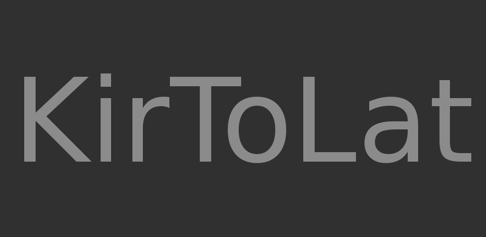

# KirToLat

[](https://github.com/slavabars/KirToLat/actions/workflows/android.yml)

**Автоизменение текста с кириллицы на латиницу.**

Android-приложение, которое конвертирует текст, набранный в русской раскладке, в
текст в латинской раскладке — символ за символом, по расположению клавиш на
клавиатуре. Пригодится, когда пароль, логин или команду набрали «не в той»
раскладке и нужно быстро получить корректную латиницу.

<p align="center">
  
</p>

## Возможности

- ⚡ Мгновенная конвертация кириллица → латиница прямо во время ввода.
- 🔠 Корректная обработка строчных и заглавных букв (`ё`, `Й`, `Ж`, …).
- ⌨️ Знаки препинания тоже переводятся: `.` → `/`, `,` → `?` и т.д.
- 📋 Копирование результата в буфер обмена одной кнопкой.
- 🕘 История скопированных строк с датой и временем (SQLite); любую запись из
  истории можно скопировать повторно одним касанием.
- 📴 Полностью офлайн, без разрешений и интернета.

## Скачать

| Источник | Ссылка |
| --- | --- |
| Google Play | https://play.google.com/store/apps/details?id=dcns.ru.kirtolat |
| GitHub Releases (APK) | https://github.com/slavabars/KirToLat/releases |

Минимальная версия Android — **5.0 (API 21)**.

## Как это работает

Раскладки ЙЦУКЕН и QWERTY «накладываются» друг на друга: каждой кириллической
букве соответствует латинская клавиша на той же физической позиции.

| Кириллица | Латиница |
|---|---|
| й ц у к е н г ш щ з х ъ | q w e r t y u i o p [ ] |
| ф ы в а п р о л д ж э | a s d f g h j k l ; ' |
| я ч с м и т ь | z x c v b n m |
| ё | &#96; |
| б | , |
| ю | . |
| . | / |
| Ё | ~ |
| Б | < |
| Ю | > |
| , (запятая) | ? |

Верхний/нижний регистр и знаки препинания обрабатываются отдельными парами,
поэтому `Привет` превращается в `Ghbdtn`, а не в набор случайных символов.
Результат можно сразу скопировать в буфер обмена, а все скопированные строки
сохраняются в локальной базе SQLite и доступны в истории с датой и временем.

## Сборка

Требования:

- JDK 17;
- Android SDK с платформой **API 34** и build-tools 34+;
- переменная окружения `ANDROID_HOME` или файл `local.properties` с `sdk.dir`.

```bash
git clone git@github.com:slavabars/KirToLat.git
cd KirToLat
echo "sdk.dir=$ANDROID_HOME" > local.properties

# debug-сборка
JAVA_HOME=/path/to/jdk-17 ./gradlew :app:assembleDebug

# release-сборка
JAVA_HOME=/path/to/jdk-17 ./gradlew :app:assembleRelease
```

Готовый APK: `app/build/outputs/apk/release/app-release.apk`.

### Непрерывная интеграция

Workflow [`.github/workflows/android.yml`](.github/workflows/android.yml) собирает
debug- и release-APK на каждый push и pull request, публикует их как артефакты
сборки, а при push тега вида `v*` создаёт GitHub Release и прикрепляет APK.

Подпись в CI: если заданы секреты `KEYSTORE_BASE64`, `KEYSTORE_PASSWORD`,
`KEY_ALIAS` и `KEY_PASSWORD`, release-APK подписывается боевым ключом, иначе —
debug-ключом.

### Подпись release-сборки

Release-сборка подписывается ключом из `keystore.properties` в корне проекта
(файл в `.gitignore`):

```properties
storeFile=keystore/kirtolat-release.jks
storePassword=...
keyAlias=kirtolat
keyPassword=...
```

Если файл отсутствует, сборка автоматически подписывается debug-ключом, чтобы
APK оставался устанавливаемым.

## Технологии

| Компонент | Версия |
|---|---|
| Язык | Java |
| Gradle | 8.7 |
| Android Gradle Plugin | 8.5.2 |
| compileSdk / targetSdk | 34 |
| minSdk | 21 |
| UI | AndroidX AppCompat, ConstraintLayout |
| Хранение | SQLite (`SQLiteOpenHelper`) |

## Структура проекта

```
KirToLat/
├── app/
│   ├── build.gradle                     # конфигурация модуля приложения
│   └── src/
│       ├── main/
│       │   ├── AndroidManifest.xml
│       │   ├── java/dcns/ru/kirtolat/
│       │   │   ├── KirToLat.java        # UI, конвертация, буфер обмена
│       │   │   └── DB.java              # SQLite-история
│       │   └── res/                     # layout-ы, строки, иконки
│       ├── test/                        # unit-тесты
│       └── androidTest/                 # instrumented-тесты
├── gradle/                              # Gradle wrapper
├── logo/                                # исходники логотипа
├── build.gradle                         # корневой build-файл
└── settings.gradle
```

Классы:

- `KirToLat` — единственная Activity: поле ввода, живая конвертация, кнопка
  «Копировать» и список истории.
- `DB` — обёртка над `SQLiteOpenHelper`, хранит таблицу `copylist` (`id`, `data`, `text`).

## Лицензия

Проект распространяется под лицензией [MIT](LICENSE).
